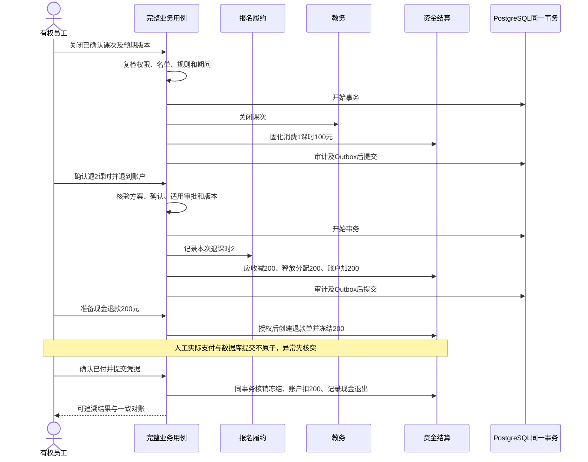

# 首个业务切片领域与操作设计

| 项目 | 内容 |
| --- | --- |
| 版本 | v0.1 |
| 状态 | Review：设计提案；SC01 基准样例已获用户确认，尚未实现或验收 |
| 创建日期 | 2026-10-31 |
| 更新日期 | 2026-10-31 |
| 维护 | 项目负责人；AI 协作者按旧证据细化 |
| 关联 | [验收样例](../../01-业务需求/业务切片/20261031-首个业务切片验收样例-v0.2.md)、[证据核验](../../06-旧系统研究/20261031-首个业务切片证据核验-v1.0.md)、[规则基线](../../01-业务需求/20261029-业务规则与验收基线-v1.4.md)、[执行路线](../../04-执行计划/20261029-后续开发执行路线-v1.55.md)、[模块边界](../总体/20261030-工程结构与模块边界-v1.4.md) |

## 1. SC01 范围与确认边界

用户已确认基准：普通报名、平均价格模式1、无优惠/服务费，1000元购10课时且收齐；一节课消耗1课时100元；退2课时200元，先回学员账户，再单独确认办理200元现金退出。确认仅覆盖这个样例和两步流程，不代表所有退费配置、审批条件、结算模式或本文件全部设计已批准。

本轮输出逻辑模型、应用操作、状态维度、授权及事务边界，不输出最终 DDL 或创建正式工程。SC01 首次实现贯通必要主数据装载、档案、产品版本、报名审核、收款分配、单班单课次草稿/发布/确认、考勤、关闭消费、部分退课时/退到账户、现金退出和对账。

多班自动排课、模式0/2–5、优惠服务费、团培、插班/跨月/历史纠错等仍在完整 P0，不因首片选择而删除。首片使用同一学校及开放财务期间是样例边界，不是新增“全产品禁止跨学校”的规则。旧数据装载需另有可核验来源快照；人工例子不冒充已迁移的真实旧学员。

## 2. 数据所有权和逻辑对象

下表为目标职责与最小逻辑字段提案，不直接一对象一表，也不继承旧表布局。所有业务主键使用 UUID；`tenantId` 来自可信身份上下文，关联同时约束同租户，学校/校区/部门等目标还须符合当前操作的数据范围。

| 所有者 | 对象与关键内容 | 权威边界 |
| --- | --- | --- |
| 组织资源 | School、Campus、Department、Employee/Teacher、Room：稳定ID、归属、状态及资源版本 | 学校为财务主体；校区与部门为学校下的平行维度；首片只装必要资源，不先建全套组织平台 |
| 档案 | Student、Contact、StudentContact：身份、关系类型、联系方式和资料版本 | 联系人和学员分开；手机号不是主键，不自动合并；将来 AI 待核实材料独立于正式主档 |
| 产品 | ProductVersion、PriceVersion：课程/购买课时、价格、适用范围、有效期、规则引用 | 发布版本不可被后续改价静默覆盖；选择价格由服务端核验，不能相信前端传来的单价 |
| 报名履约 | Enrollment、EnrollmentLine：学员/学校、产品及价格快照、课程/购买课时、约定金额快照、结算规则版本、审核维度 | 报名是履约单元；合同原始约定是不可变来源，当前应收变化由资金调整事实确定，不另养一套权威余额 |
| 教务 | Class、Membership、Lesson/Draft、Attendance：班级资源、报名入班起止、时段、授课/消费课时、发布/确认/关闭维度 | 同一报名首片只有一个当前主班关系；转班保留历史；考勤明确事实及原因，费用按规则计算 |
| 资金结算 | Charge/ChargeAdjustment：原约定来源、应收增加/减少及原因、期间/版本 | 资金模块拥有当前净应收；报名金额快照不被退款直接覆盖，报表不自行调整余额 |
| 资金结算 | CashReceipt、Allocation、AllocationRelease、AccountEntry：正向收款、来源分配、退回来源、不可重复的账户流水 | 收款不等于报名已分配；余额为同一资金来源流水的受控汇总/投影，不让档案或报名分别维护余额 |
| 报名 + 资金编排 | HoursCancellation、RefundEntitlement：本次退课时、对应课程、可退费用及规则/审批来源 | 履约拥有已退课时；资金拥有应收减项与退款权益；两者通过一次业务用例同事务落地 |
| 资金结算 | CashRefundOrder、AccountReservation、CashRefundRecord：退款来源、确认/审批、冻结、实际退出凭据及执行状态 | 退到账户后仍是系统管理的余额；实际现金退出是另一笔资金事实，不能拿退课时单冒充现金已退 |
| 资金结算 | LessonConsumption：报名/课次、消费课时/金额、结算规则/输入版本、财务期间与固化来源 | 关闭课次时生成；同一报名×课次只允许一个有效入账结果，纠错走关联调整，不覆盖固化历史 |
| 报表 | ReconciliationSnapshot：受控指标/过滤、结果快照、读取时点和版本 | 只读组合权威事实；不能通过报表查询触发结算或按新规则重算历史 |
| 公共受控能力 | OperationExecution、AuditEvent、Outbox：幂等身份、结果引用、可信发起/执行身份、变更和待处理事件 | 不作为资金账替代品；成功关键审计与业务同事务，失败/拒绝另行记录，事件不依赖内存回调 |

课次的钟表分钟、授课课时和学员实际消耗课时分开。SC01 采用明确的60分钟/1课时样例；不能把旧 `getCSHourMinutes()` 内部基准推广为新系统所有班型必须按60分钟上课。

关键关系：一个学员可以有多条报名，一条报名有课程明细和历史入班关系；一条收款可分配到多个履约单元，每笔释放关联原分配；退课时单关联课程退量与资金调整，现金退款单再关联已退到账户的来源。课次消费关联报名和课次，不能只关联学员，否则多条报名会互相覆盖。所有跨对象关联验证租户，学校等维度按动作的业务规则验证，不只检查外键ID存在。

## 3. 状态维度

| 对象 | 建议维度 | SC01 要求 |
| --- | --- | --- |
| 报名 | 履约状态、审核状态、入班关系、财务锁定分别表达 | 新登记先待审核，显式审核后进入样例后续流程；部分退2课时后仍有有效履约，不自动变成已退班 |
| 课次 | 草稿/发布、授课确认、财务未关闭/已关闭，锁定/补课等正交维度 | 草稿保存不等于发布；发布不等于已授课或已消费；先确认再关闭，已关闭不能普通编辑 |
| 考勤 | 明确出勤事实、例外原因及对应规则版本 | 主例显式登记正常出勤，不把“没有考勤记录”等同于全产品默认出勤 |
| 收款 | 待确认、已确认、已冲正；审核信息独立保留 | 未确认款不得变成可分配余额；已确认事实不能任意 PATCH 金额或删除 |
| 退课时方案 | 可计算、待确认/审批、已失效、已执行 | 方案持久关联规则、来源和版本，页面改变关键条件后需要重新计算/确认 |
| 现金退款单 | 已准备/待支付、已记录支付、已取消、待核实等执行状态 | 准备时冻结资金；只有有权人员确认已付并提供凭据后记实际退出；结果不确定时不自动再付款 |

上述名称是设计提案，不把旧布尔字段逐一改名后当作状态机，也不预先锁定全部枚举代码。

## 4. 统一操作契约

每个公开动作说明：稳定操作名、用途、输入单位、输出/错误、当前主体及租户、功能/数据/字段权限、状态/并发前提、幂等、确认/审批、事务、副作用和审计。HTTP、受控任务及未来 Agent 都调用这个入口。公开模块契约不等于全部自动成为 HTTP 或 Agent 工具。

修改请求使用限定于租户/主体/动作的幂等键，并按资源携带预期版本；同键不同语义拒绝，同键重试不重复执行，读取历史结果仍重新鉴权。报价/确认凭证与幂等键职责不同；凭证绑定实际金额、课时、方案/资源/规则版本、主体、用途和有效期，消费时复检。调用方的 `tenantId`、余额、`approved=true` 或 `confirmed=true` 不构成可信事实。

| 操作 ID / 建议名称 | 输入与输出重点 | 授权、并发与执行重点 |
| --- | --- | --- |
| SC01-OP01 `previewLegacyLoad` | 来源快照/映射、选择范围 → 依赖、校验和影响 | 只读预检；普通材料/导入配置不能指定任意数据库或执行 SQL |
| SC01-OP02 `applyLegacyLoad` | 已核验装载计划与版本 → 新ID/旧ID映射、差异 | 受限迁移入口；按业务单元提交/重跑，不清库、不把合成数据当真实旧快照 |
| SC01-OP03 `createStudentProfile` | 结构化学生/联系人关系 → 主档及版本 | 同手机号提示核验，不自动覆盖/合并；旧档关联须明确授权及确认 |
| SC01-OP04 `registerEnrollment` | 学员、学校、可售产品/价格版本 → 一条报名及应收来源 | 服务端核价及冻结快照；报名、课程明细、原始应收、审计同事务；不默认同时收款 |
| SC01-OP05 `approveEnrollment` | 报名ID、预期版本 → 审核状态 | 审核权限及适用范围；不允许普通修改接口任意设置审核标志 |
| SC01-OP06 `confirmReceipt` | 学员、学校、正金额、方式/凭据、预期账户版本 → 收款/流水 | 财务授权；首片记录线下实际收款，不等于发起银行扣款；可用余额增加仅一次 |
| SC01-OP07 `allocateReceipt` | 资金来源、报名/课程分配、金额 → 分配结果 | 检查来源可用、学校/学员关系及应收；分配、余额去向、审计同事务，不超分 |
| SC01-OP08 `placeEnrollmentInClass` | 报名、班级、进班时间与版本 → 主班关系 | 资格、班级范围/状态、当前关系与容量；保留历史，不跨模块直接写教务表 |
| SC01-OP09 `saveLessonDraft` | 班级、时段、课程、教师/教室及资源版本 → 草稿 | 保存时按该操作的约束检查；草稿不是已发布占用，发布须在锁/约束内重检资源 |
| SC01-OP10 `publishLesson` | 草稿ID/版本、确认凭证 → 发布结果 | 发布权限与确认；资源冲突、过期方案拒绝；通知若启用另有可靠事件，不让通知决定发布成败 |
| SC01-OP11 `confirmLessonAttendance` | 课次/名单版本、实际授课与出勤 → 确认结果 | 显式出勤/例外记录；保存考勤不提前记消费，已有固化结果禁止普通回改 |
| SC01-OP12 `closeLessonAndPostConsumption` | 已确认课次、相关报名/规则/期间版本 → 关闭及消费结果 | 关闭、消费固化、关键汇总、审计/Outbox同事务；同一课次有效入账唯一，锁月/退课时竞争须串行或冲突返回 |
| SC01-OP13 `previewHoursCancellation` | 报名、课程、本次退课时 → 可退费用/来源、影响、确认要求 | 公式由规则计算，调用方不直接指定权威退款额；读取受权限约束，预检不占用长事务 |
| SC01-OP14 `cancelHoursAndReturnToAccount` | 方案ID、预期版本、幂等键、确认/适用审批凭据 → 退课时单/费用减项/退回账户结果 | 首片SC01一次完成履约退量、应收减项、原分配释放和账户流水；确认与执行之间变化时重新计算，不静默改变200元 |
| SC01-OP15 `prepareCashRefund` | 退回来源、正金额、方式/学校、版本、确认/适用审批 → 退款单与冻结引用 | 必须是可退的账户资金；冻结与退款单同事务，可用余额不足拒绝，不在此伪造已向家长支付 |
| SC01-OP16 `confirmCashRefundPaid` | 退款单、实际支付凭据/日期、预期版本及幂等键 → 实际退出记录 | 执行前复检权限/审批/冻结；账户扣减、释放冻结、实际退出、审计同事务，不以模型或浏览器回调声称已付 |
| SC01-OP17 `cancelUnpaidCashRefund` | 退款单版本、原因 → 取消及解冻 | 仅确认尚未支付且允许取消时执行；已支付或结果待核实不能当普通取消释放资金 |
| SC01-OP18 `queryReconciliation` | 已定义指标、学校/报名范围 → 一致快照及明细引用 | 授权先于聚合；一次快照核对课时/应收/分配/账户/收支，不能拿不同读取时点拼成一致结果 |

对员工的两个步骤仍是“退到账户”和“现金退出”；现金退出内部的准备/冻结与已付确认是保障真实资金处理的设计提案。审批条件按机构规则核验，主例使用已具备的有效审批或明确适用的不需审批规则，不因样例确认就关闭审批或写入永久放行配置。

## 5. 事务和依赖

| 业务事务 | 必须一起提交 | 提交后可异步 |
| --- | --- | --- |
| 报名成立 | 报名/课程快照、购买课时、原始应收来源、成功审计、需要的待办 | 搜索/统计投影和提示 |
| 收款确认 / 分配 | 各自的单据、资金去向/账户变化、并发版本、审计 | 收据生成/通知；组合工作台可显式协调多个事实，不混为一个金额字段 |
| 发布课次 | 草稿版本校验、发布结果、有效资源占用、审计/Outbox | 师生通知；首片可不接通知渠道 |
| 课次关闭 | 关闭状态、课次×报名消费、规则/期间固化、关键汇总、审计/Outbox | 非权威报表投影；不异步补齐缺失的消费权威事实 |
| 退到账户 | 本次退课时、应收调整/退款权益、原分配释放、账户流水、结果/审计/Outbox | 提示、凭证；现金不在此被默认视为已退 |
| 现金退款准备 | 退款单、来源预算、余额冻结、审计 | 人工支付待办 |
| 已付确认 | 退款执行记录、冻结结转、账户扣减、实际资金退出、审计/Outbox | 通知和报表投影 |

一套单向用例编排调用报名、教务和资金各自公开契约，各模块只写自己数据。报名约定快照不依赖资金内部余额，教务不直接写资金表，资金不回调教务内部实现；避免报名↔资金、教务↔资金循环依赖。内部组合步骤不注册为任意外部调用入口；完整动作在应用入口授权，局部写入继续校验自身不变量，模块依赖进入自动检查，不新建通用工作流引擎。

并发协议必须覆盖当前报名/分配/账户、课次资源及学校财务期间，不能只锁一个付款行。对同一学员资金用例采用一致顺序；锁月与关闭/退课时在同一期间保护协议下串行，检查版本及影响行数，事务内不得等待人工、模型、文件渲染或外部支付。锁细节与最终约束在正式数据设计中落实，本轮不把旧进程内锁当分布式保障。

现金已经实际交付与数据库提交无法视为一个本地事务。若已支付后确认超时，先按退款单/幂等身份查询是否提交并核对凭据，保留冻结/待核实处理，禁止自动再发一次现金或按失败直接解冻；数据库不可写时也不能伪称异常记录已持久化。

## 6. 指标与边界

SC01 的原始约定1000、有效应收、有效分配、已消耗、账户总额/冻结/可用、实际收款/现金退出分别展示。公式与每步期望统一在[验收样例](../../01-业务需求/业务切片/20261031-首个业务切片验收样例-v0.2.md)维护，不在前端、导出、AI 各算一份。对账为本业务系统口径，不宣称已设计完整总账或法定财务报表。

只预留可独立调用的操作、方案/证据版本、授权/确认、幂等与结果追溯。未来 AI 提取档案存待核实草稿、排课存草稿；本轮不实现模型、聊天界面、外部 Agent 协议或无人值守任务。

## 7. 进入实现前的局部准备

SC01 的主样例与两步退款已确认；本设计仍需结合正式工程落实字段/精度、唯一/关联约束、版本及索引、审批配置和具体岗位矩阵。定位可用旧装载快照并验证映射；若暂无可核验快照，人工金标准可以先行，但不能把它宣称为旧库迁移通过。

依赖已完成的 R3 原型作为技术输入，不复制验证表为业务表。后续最小开发任务依序落实：组织/身份/档案/产品最小数据与契约 → 报名/应收 → 收款分配 → 主班/课次与消费 → 两步退款 → 对账及失败/并发/第二入口；完整 P0 同步保留，正式工程启动范围另行明确。
