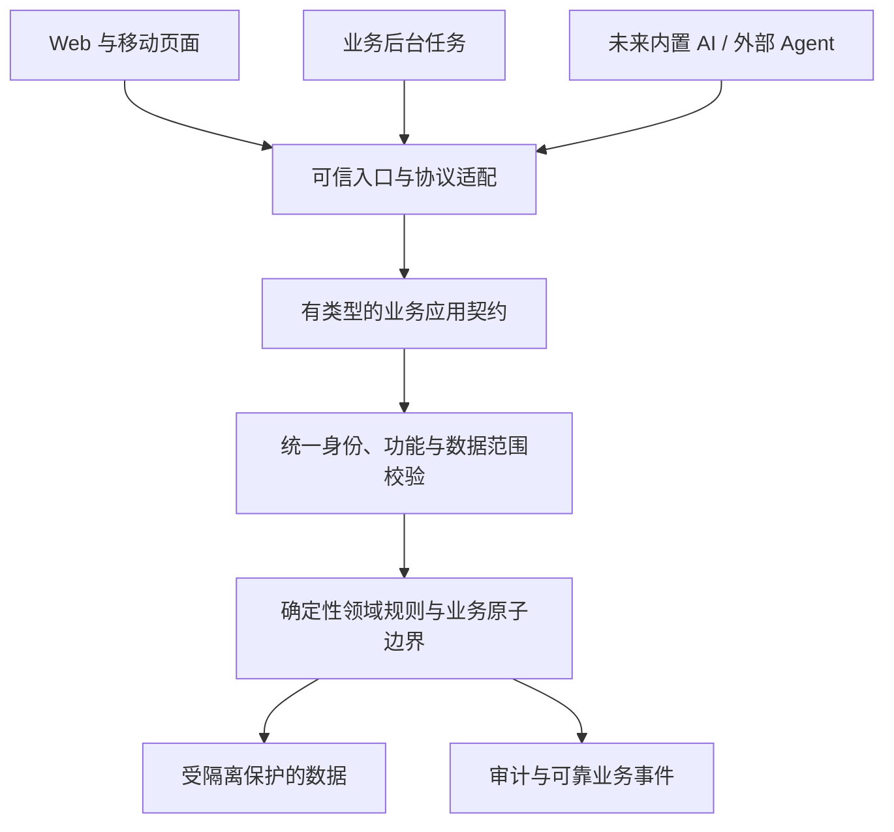

# 架构原则与 AI 能力预留

| 项目 | 内容 |
| --- | --- |
| 版本 | v1.2 |
| 状态 | 架构约束；技术主线与 AI 定位已确认，具体实现继续设计 |
| 创建日期 | 2026-10-29 |
| 更新日期 | 2026-10-31 |
| 维护 | 项目负责人 |
| 关联 | [项目基线](../../00-项目基线/20261029-项目基线-v1.16.md)、[业务规则](../../01-业务需求/20261029-业务规则与验收基线-v1.4.md)、[执行路线](../../04-执行计划/20261029-后续开发执行路线-v1.51.md) |

## 1. 目标与实施边界

系统首先是可靠的业务产品。底座应支持人通过页面、后台任务、未来内置 AI 或外部 Agent 操作同一业务，避免不同入口重复实现规则和授权。

当前不开发 AI 助手、模型网关、MCP 服务、向量库、对话编排或主动巡检。现在确定契约和约束，随真实业务落实可靠执行，等 AI 开发启动后再增加模型、协议和交互适配器。

已确认 Java/Spring Boot、PostgreSQL 与 React/TypeScript 主线，详见[技术决策记录](../../05-决策与问题/20261030-技术决策记录-v1.19.md)。本文件仍侧重逻辑边界；消息系统、接口实现和部署布局等继续设计。图中的节点不要求各自成为独立服务。

AI 初期作为辅助助手，后期保留成为主要操作入口的可能。普通业务页面独立完成业务，助手通过同一业务操作提供补充入口。草稿、确认、执行和结果等保存在业务系统，不以聊天文本作为唯一事实来源；当前不实现 AI 功能或生成式界面。

## 2. 逻辑边界

应用契约表达“允许执行什么业务”，入口只负责认证、协议转换和上下文构造。授权、输入校验、状态前置条件、并发检查、金额计算和约束判定不能仅存在于页面或 HTTP 控制器。

## 3. 业务分区与数据所有权

| 逻辑职责 | 拥有的主要事实 |
| --- | --- |
| 租户与产品运营 | 开通、订阅、配额、机构配置与可用状态 |
| 身份与授权 | 账号、角色、功能权限、数据策略、会话与未来委托 |
| 组织与资源 | 学校、校区、部门、员工、教师、教室及占用资料 |
| 产品与价格 | 课程、班型、产品、价格版本、优惠规则与服务费 |
| 招生与客户 | 线索、渠道、公私海、分配、跟进与转化 |
| 学员与报名 | 档案、家长关系、报名履约、进退转班与合同关系 |
| 教务与排课 | 班级、课次、约束、草稿、发布、确认和考勤 |
| 资金与结算 | 收款及分配、账户流水、消耗、退款、差额、财务期间与对账 |
| 教学服务 | 作业、反馈、访谈、学习计划、考试等 |
| 报表与交付 | 指标、查询投影、导入导出、打印和下载授权 |

这是领域设计起点，边界在 R1/R2 阶段验证，不要求一行对应一个代码包、数据库或部署单元。通知、文件、审计与配置按职责承载，不建立包揽所有业务的公共杂物模块。

数据只有一个权威归属，其他职责通过公开契约或可重建投影使用。报名与财务不能各维护一份权威余额。跨域强不变量的原子边界先于部署拆分，不能用异步事件掩盖半成品交易。

## 4. 公开业务契约

每个公开操作应说明名称与版本、输入输出、目标对象、必需功能权限、数据范围、前置状态、版本条件、幂等语义、事务范围、审计和副作用。查询与修改分别表达，不要求采用特定 CQRS 框架。

例如排课具备“查询可用资源、生成方案、保存草稿、预检、发布、取消”等动作；资料具备“建立待核实草稿、匹配候选、核实、覆盖字段、合并”等动作。动作来源于真实业务，不为未来 AI 人为拆碎简单操作。

公开 DTO 与内部持久化结构分开，避免页面和未来工具绑定数据库实体。错误提供稳定业务码、字段或约束原因与关联标识，让页面、任务和未来 Agent 都能判断应补信息、重试、重算还是停止。

不创建接受任意方法名、表名或任意 JSON 就能修改所有业务的万能入口。不把整个内部接口清单自动开放为 Agent 工具；真正开放时按权限和任务范围选择。

## 5. 统一身份与委托边界

现在定义与凭据形式无关的调用身份及执行上下文，包含租户、主体、来源和请求追踪信息；选型后实现正常用户入口。将来可扩展客户端、委托、任务和工具调用标识。

这些身份由可信认证入口建立，不由模型输出或普通业务参数决定。跨线程、任务和跨进程要显式传播并验证上下文；缺失时拒绝。一次业务原子操作中不能中途切换租户。

未来外部 Agent 的有效权限是：员工当前有效权限 ∩ 管理员对客户端的允许范围 ∩ 员工授予的委托范围 ∩ 本次业务规则。显式 deny 继续优先，字段、查询、导出和附件访问也适用。

委托可以撤销、到期与收窄；每次执行检查当前授权。普通网页完整凭据不能作为长期第三方凭据。凭据受众、签发、交换和授权发现具体方案留待接入阶段设计，不现在搭建完整授权平台。

平台跨租户操作与租户日常业务分开；平台权限不能因内部任务、AI 调用或资料检索而自动泄漏给租户主体。

## 6. 风险、草稿、确认与审批

| 操作 | 需求原则 |
| --- | --- |
| 读取普通业务数据 | 授权范围内直接执行，敏感字段按独立策略 |
| 资料提取、排课方案 | 可以自动生成并保存待核实资料或排课草稿 |
| 普通业务修改 | 根据明确授权与业务规则执行，并非所有修改一律弹确认 |
| 匹配已有档案、覆盖、合并、发布课表、通知 | 当前举例已要求确认；具体凭证与界面以后设计 |
| 退款、冲正、锁月及权限变更 | 按业务风险和岗位职责定义确认、审批与执行权限 |

风险策略由服务端业务规则控制，不能只写在提示词、工具描述或外部 Agent 的界面里。

需要确认的方案绑定具体业务动作、对象、参数或内容摘要、当前版本、租户、主体和有效期。提交时重新鉴权与预检，过期或内容变化必须重新确认。模型传入 `confirmed=true` 不构成有效批准。

审批通过与实际执行分开记录；执行失败、取消、部分完成和重试有明确业务状态。简单操作不强制实现通用多阶段确认引擎。

## 7. 可靠执行与业务原子性

- 关键非幂等写操作有持久化请求身份，重复调用返回同一业务结果；相同键不同参数拒绝。
- 幂等结果也检查当前授权，不能通过缓存读取已失去访问权的对象；重试键稳定，不因模型重新规划而改变。
- 以数据库约束、版本和明确事务/补偿协议保证并发正确性；内存锁不能成为多实例最终保障。
- 收款分配、消耗入账、退款流水等强不变量同一原子边界；投影、消息、通知可在提交后可靠异步处理。
- 长任务持久化输入引用、状态、进度、结果、取消与重试信息；领取、租约、超时和恢复机制随选型设计。
- 数据快照、算法参数与版本明确；排课计算、外部请求、模型调用和人工等待不占用长业务事务。
- 任务执行检查租户、主体和授权是否仍有效；不只在入队时检查，也不长期保存网页登录凭据续命。
- 事件可靠发布与业务变更一致提交；消费者幂等、可重放、顺序规则明确；不承诺所有外部调用天然“恰好一次”。

以上随收费、排课、导出等真实需求落地，不把每个低风险 CRUD 都改为异步任务。

## 8. 审计、资料来源与统计语义

业务动作记录执行主体、来源、对象、影响、结果和关联标识；未来补充客户端与委托，不要求现在建立 AI 专属字段和数据表。成功修改与审计的一致性、失败及拒绝尝试的记录分别设计。

导入来源对象、材料版本、字段证据、核实状态与正式档案分开。未知、冲突和候选关系显式返回，不能由模型猜测填满。原始材料、提取结果、正式业务数据有各自访问与删除规则。

报表指标目录记录名称、单位、公式、时间归属、合法维度、权限和版本。页面、导出与未来问数共用受控查询服务；组合查询有开销、行数和超时限制，显示数据截止点。复杂分析需求出现后再评估分析存储或 BI 工具。

未来知识检索在候选选择阶段就限制租户与资源权限；不能先把无权材料发给模型，再过滤答案。索引和向量是可再生投影；授权撤销、删除和版本变化覆盖缓存及检索。没有实际文档问答需求时不提前建设向量库。

聊天、截图、附件和外部返回都视为不可信材料，其中的指令不能改变授权、工具白名单或业务规则。

## 9. 客户内网部署

业务核心不能依赖公有云模型才能运行。将来 AI 层接云端或内网模型，业务契约保持一致；本地模型能力不足时应明确降级为人工或受限模式，不假设任意模型都支持视觉、结构化输出和工具调用。

无公网时内网业务与本地模型可运行；公网渠道同步明确暂停或不可用，不得暗中回退云端。安装、升级、授权和必要依赖的离线方案在交付设计中验证。

这不增加个人电脑离线编辑 SaaS 再同步的要求。

## 10. 实现时机与架构验收

| 时机 | 内容 |
| --- | --- |
| 设计与底座 | 业务所有权、应用契约、统一身份与授权、隔离、校验、错误和追踪规范 |
| 随业务实现 | 状态、草稿、预检、确认、幂等、版本、可靠任务、审计、事件、数据来源与指标 |
| AI 开发启动后 | 模型连接器、对话、追问、解析、工具选择、MCP 等协议适配、外部委托产品、知识检索、费用与评测 |
| 未确定 | 主动巡检和无人值守处置；另行确认范围及风险 |

底座验收用确定性测试和模拟第二入口完成：绕过页面仍完整鉴权；同一操作多入口行为一致；重复执行不重复入账；过期方案无法提交；任务重启可恢复或明确失败；权限撤销后不继续越权；数据来源和结果可追溯。无需先连接大模型来证明底座可复用。
