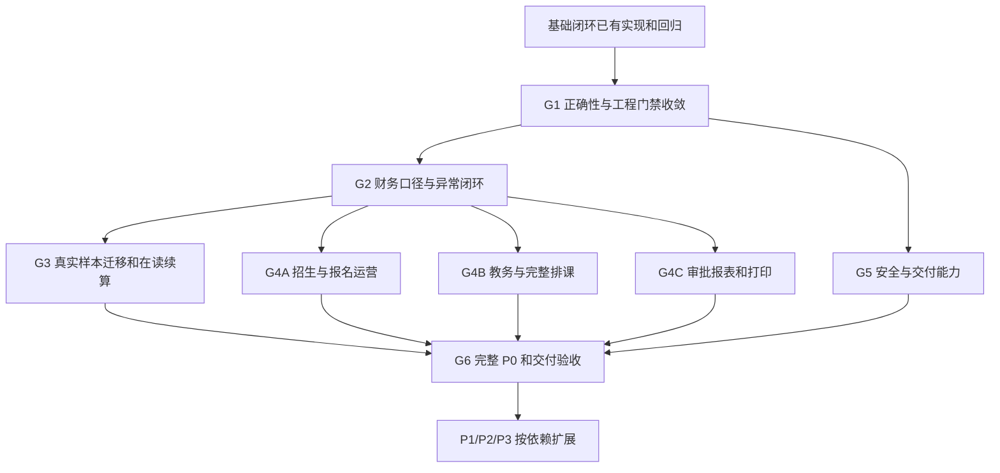

# 后续开发执行路线

| 项目 | 内容 |
| --- | --- |
| 版本 | v1.71 |
| 状态 | 当前唯一执行路线；2026-11-04 G4 初版验收口径更新；建议顺序待负责人讨论，不代表上线批准 |
| 创建日期 | 2026-10-29 |
| 更新日期 | 2026-11-04 |
| 维护 | 项目负责人；AI 协作者维护任务与证据 |
| 关联 | [项目基线](../00-项目基线/项目基线.md)、[功能全集](../01-业务需求/业务功能清单.md)、[功能进度台账](系统功能拆分与完成情况.md)、[审阅报告](20261103-项目审阅与纠偏报告.md)、[问题登记](../05-决策与问题/待确认问题登记.md) |

## 1. 当前定位与使用规则

审阅基点 `1b39264` 的 SC01 人工金标准主链已有自动验证，其后首批正确性防护和招生子项继续推进。R4 工程交付、R5 真实旧样本与人工验收尚未全部退出，完整 P0/R7 未完成。**下一主线：保留已修防护 → 确认受影响业务口径 → 真实样本迁移续算 → 补齐 P0 → 整体交付验收。** 各项当前状态见下表及[细项追踪](功能细项追踪.md)，统一查看[开发总览](开发总览.html)。CI、文档和安全恢复等不依赖业务回答的工作可以同步推进。

P0～P3 表示业务范围，R0～R9 是原阶段框架，下面 G1～G6 是本轮收敛后的验收关口；三者不是不同工期安排。仓库不记录工期、人员编制或承诺交付日期。阶段按退出证据推进，不以代码行数或测试数量关闭。

历史 BIZ-S01～S32、CORE/ORG 等实施批次保留在 Git 历史和各功能验证记录；不再在本文件追加聊天式流水账。当前完成情况只更新[功能台账](系统功能拆分与完成情况.md)。本路线不撤销已确认技术决策、不隐式缩减 P0、不自动授权部署、提交或推送。

## 2. 推进路线图

AI 仍只保留底座；相关业务成熟后可单独定试点，不要求等全部后续范围。图中的三条 P0 工作链表示业务依赖可分开准备，不代表已批准人员安排或要求并行代理。

| 关口 | 当前状态 | 核心交付与退出条件 |
| --- | --- | --- |
| G1 正确性与门禁 | 主要技术缺陷已修复，专项与远程验证待完成 | 课时上限/模式 2、优惠防重、CI 清洁生成、新模块边界、导出、危险恢复入口有修复与回归；技术缺陷不等用户确认是否应修 |
| G2 财务规则 | 局部实现，关键口径待确认 | 同一组案例覆盖模式 0～5、优惠/服务费/退课/现金、分配守恒、跨期调整、六类审批的财务部分；财务预期及版本边界明确 |
| G3 真实迁移续算 | 管道局部实现，无真实样本验收 | 源快照、映射版本、四模式能力、依赖闭包、干跑/提交、批次行级对账和异常重跑；迁后继续消费/退款/锁月与旧期望一致 |
| G4 完整 P0 | 多模块局部实现 | 功能全集每个 P0 行有 F/REV/验收映射；招生、多产品/转班、补课、多班自动选资源、报表与打印等补齐；变更范围有负责人记录 |
| G5 可交付 | 本地可查看，生产链未验证 | GitLab Runner、Linux 镜像/Compose/入口、初始化/密钥、安全审计、配套异机恢复、运行观测和容量证据齐全 |
| G6 总体验收 | 未开始 | 业务、财务、教务与运维按岗位和真实规模验收；迁移切换及写入前后回退均演练；负责人明确批准后再安排真实上线 |

## 3. 纠偏与开发任务清单

“可开发”表示不需要新增业务决定即可处理的实现问题；“待局部确认”只阻断受影响分支。每项实际开始时再记录明确输入、非目标、提交范围与验收案例，不先搭通用平台。

| ID / 关口 | 范围与依赖 | 当前状态 | 交付及验收要求 |
| --- | --- | --- | --- |
| REV-001 / G1 | F24 课时上限/模式 2；AUD-01，Q40 | 总上限与跨界拒绝已修并本机回归；最终超界处置待确认 | 区分计价分母与总/课程封顶；整数/小数跨界、不同课程、退后续算；不允许超耗或静默负剩余；复跑定向失败案例和全套资金/课时测试 |
| REV-002 / G1→G2 | F13/18/19 优惠防重及财务金标准；AUD-02/03，Q1～8、Q30/31、Q34～39 | 防重、直接改价限制和期间检查已有回归；业务金标准待确认 | 请求身份+摘要+历史结果鉴权；重复不再减应收；定义已有分配/消费后的调整权限、审批、规则版本与守恒；沿用旧行为的分支明确保留或更正规则 |
| REV-003 / G2 | F18/25/26/27 期间、审批、冲正/差额、服务费、团培；依赖 REV-002 口径 | 需财务局部确认 | 缺失审批策略不能悄然放开；六类审批逐项接执行；财务日期、锁月旁路、跨期更正和收入/余额关系有完整案例与并发验证 |
| REV-004 / G1 | F03/37 架构与不变量测试；AUD-11/12 | 本轮实现及本机组合验证已完成；岗位与生产容量验收归 REV-018 | 正式模块 internal/server/循环门禁及跨域表清单/SQL 门禁；54 项撤权/停校/关课/退款/锁月、回滚及重复组合；9 处停校缺口和退款动作目录已修；锁等待及收款小样本见[验证记录](../03-研发规范/工程质量/验证记录/20261103-REV-004异常与并发组合验证记录.md)，保持机构锁 |
| REV-005 / G1、G5 | F34 GitLab 清洁流水线；AUD-08 | 配置与契约传递已修；远程 Runner 未验证，依赖 Q26 | 一致测试凭据、PG 客户端、JDK/Maven/pnpm/镜像固定、Testcontainers 可用；后端实际导出契约→产物传递→前端生成；全链无跳过，保留结果；GitHub 只作备用 |
| REV-006 / G3 前置 | F31/32 迁移领域边界与预检；AUD-05/07，C1～C6 | 旧确认入口已停用；受控契约与策略待完成 | 源库+旧主键映射；领域受限导入契约；真实源数据剖析，关系/状态/金额/课时/锁账全部有承接；阻断级差异不落业务库 |
| REV-007 / G3 | F19/32 期初批次及真实续算；依赖 REV-002/003/006，AUD-06 | 逐行原子、清单和重试状态已实现；跨批更正及真实样本待完成 | 行指定目标报名、源快照与规则；校验/提交同口径；明确原子行或部分成功；逐批逐行核对余额、消费金额/课时、退费、未收及状态；多报名、多批次、失败重跑不误记 |
| REV-008 / G1 | F29 CSV 完整性与文本防护；AUD-10 | 超限拒绝、公式保护与失败提示已修并本机验证；完整导出另见 REV-013 | 超 5000 明确拒绝/分段且用户知道范围；公式样文本以安全文本输出；权限和字段脱敏不回退；不能只用小数据证明全量导出 |
| REV-009 / G4A | F09/10 招生到学员；依赖已有组织/档案，BQ-04/05 | 学校渠道、负责人客户与提醒、公海释放/认领、同负责人线索合并/撤销、客户转学员及联系人归属已有切片；客户与学员同校负责人转派分别采用 `CUSTOMER_ASSIGN` / `STUDENT_ASSIGN` 权限，并有版本、请求摘要幂等、原因及审计；学员目录增加按字段权限过滤的格式化电话检索；见[客户负责人转派验证](../03-研发规范/工程质量/验证记录/20261104-G4客户负责人转派验证记录.md)、[学员负责人分派验证](../03-研发规范/工程质量/验证记录/20261104-G4学员负责人分派验证记录.md)和[学员电话检索验证](../03-研发规范/工程质量/验证记录/20261104-G4学员电话检索验证记录.md) | 仍需团队分配/自动回收、学员合并/撤销与完整岗位矩阵；学员默认归属、客户转换继承和负责人可见范围待 Q69，电话部分/精确匹配与号码标准化待 Q70；客户转换撤销/更正、公海范围及跨负责人权限待 Q57/Q58 确认 |
| REV-010 / G4A | F12/14～17 产品与报名运营；依赖 REV-002/003；BQ-09 | 产品组、多产品报名、仅服务费零课程行报名已有局部实现；同校同课程转班及班级退班审批执行首切片已实现，只改成员关系并保留原报名资金/课时事实，候选边界见 Q60/G4 验证 | 正式价格/服务费目录、活动券、多班/插班、定金/定转费、反审核、跨课程/跨校转班、延期及费用课时原子转移；票据/银行/发票基本资料补齐 |
| REV-011 / G4B | F06/20～24/38 完整教务；依赖 REV-001，Q7/8/13～17 | 班级结班与空班取消、单/多班顺序自动选资源、部分缺勤分钟消费、教师本人课表与班级只读工作台已有验证切片；后端全量回归见 G4 全量验证记录 | 仍需完整班级生命周期、校历/节假日/教师资质/路程冲突规则、无解原因、调补换课和本人操作工作流；Q61/Q66/Q68 待确认 |
| REV-012 / G4C | F27/28 审批与指标；依赖稳定事实，BQ-01/02 | 审批单申请/决定/撤回/失效、动作目录、申请持久幂等及现有权限目录分级已有切片；同校同课程转班和班级退班已有 0 元批准后执行、待审拒绝回滚/稳定请求幂等首切片；学校资金累计对账、资源日程日报、按日收款统计、逐报名学员消费对账及逐课次考勤人数首切片有证据；2026-11-04 后端全量 399 项、前端全量 73 项通过，类型检查/ESLint/变更文件 Prettier/构建通过，见[学员电话检索验证](../03-研发规范/工程质量/验证记录/20261104-G4学员电话检索验证记录.md) | 延期/减款等批准后执行器及其余报表/查询仍未完整交付；指标、期间、正式岗位矩阵和来源待 Q55/Q62/Q65 确认，并须逐项与账和课时对平 |
| REV-013 / G4C | F08/16/29/30 文件、可靠任务、xlsx/PDF；依赖已有业务事实 | 现有同步 CSV 和 PDF/任务架构决策不构成持久任务交付；G4 持久导出与正式打印链仍待实现 | 以持久导出/排课真实用例落地 db-scheduler/Outbox；进度、重试、取消、崩溃恢复、撤权下载；合同/收据/听课证/课表快照和正式原件、重印更正；保留期/编号/样件见 Q63 |
| REV-014 / G4A、G5 | F01/04～07/39 主数据与租户运营、短信；Q43、BQ-11 | 学校/人员/教室资料已有基础切片，统一字典、租户订阅配额、品牌域名及短信台账/回执尚无完整业务链 | 补齐资料字段、字典与编号、学校参数和租户开通/订阅/配额；接入负责人指定的短信供应商及发送台账/回执；商务配置和供应商待 Q64 确认 |
| REV-015 / G5 | F02/03/11/33/38 权限、安全与审计；BQ-05/06、Q18～21/33/38 | 局部实现 | 操作×范围×字段矩阵覆盖读写选项报表文件；登录限流/日志、首次改密、撤销并发、审计查询/保留；平台身份与租户后台分开，不通过脚本默认全权 |
| REV-016 / G5 | F35 Linux 交付；依赖 REV-005，Q44/45 | 未验证 | 镜像/Compose/Nginx/HTTPS、配置/密钥文件校验与轮换、初始化、维护停写、升级迁移/兼容/回退、无公网运行；保留初期 A 发布方式，不提前实现全套 B |
| REV-017 / G1、G5 | F08/33/36 恢复安全及运行保障；AUD-09，Q28/45 | 同源及已有目标保护已修；配套恢复和异机演练未完成 | 不允许删除外来或源库；非空数据和全表内容/关键汇总、角色权限、RLS 实测、附件/配置/密钥及异机恢复；恢复后继续 SC01；告警触达和故障处理有证据 |
| REV-018 / G6 | F01～39 总验收；依赖 G1～G5 | 未开始 | 功能到需求的逐项追踪、岗位浏览器端到端、容量/安全/迁移切换、写入前后回退；差异例外明确负责人结论；关闭 P0 和生产开放单独批准 |

## 4. 推荐下一批的具体范围

本轮先收敛了 **REV-001 的不变量、REV-002 的请求防重、REV-004 的边界门禁、REV-005 的 CI 配置、REV-008 的导出防护、REV-017 的目标库保护**，以及期初和审批的部分风险。验证及未完成项见[纠偏验证记录](../03-研发规范/工程质量/验证记录/20261103-收敛纠偏验证记录.md)。

最后集中纠偏批次已围绕 REV-006/007 加固：旧库确认导入停用，暂存保留并拒绝跨校覆盖；期初批次保留完整清单、逐行状态和重试约束，业务日期必填并在教务入口检查锁月。原始行有误时仅将失败行更正后另建批次，不得重复导入成功行；原批次保持未完成。

REV-006 已开始落地[旧库只读预检契约](../02-架构设计/报表与数据交换/旧库只读预检契约.md)：检查有限输入、学校档案与期间条件，并明确未检查范围；预检不授权提交。下一步按依赖梳理受控旧库写入契约、持久源身份与跨批次更正方案，结合脱敏真实样本补充预检，并准备 REV-003 财务金标准案例。真实数据迁移和受业务选择影响的规则须先确认相关口径。审批漏配或停用时拒绝退费，投入使用前须由学校配置明确阈值。Runner 未就绪则保留远程未验证状态。

G2 已建立[财务算例与闭环追踪](../02-架构设计/结算模式/G2财务算例与闭环追踪.md)，记录模式 4 组合的人工预期、当前实现边界及剩余项；不能将单一算例视为 G2 已完成。财务规则确认后扩展其余模式与异常动作，并以同组案例检查迁移后续算，再推进 G4 扩面。招生需求梳理、排课样本整理、报表指标目录可在等待财务回答时继续。

## 5. 用户讨论与材料依赖

| 优先级 | 讨论/材料 | 阻断范围 | 等待时可继续 |
| --- | --- | --- | --- |
| 第一组 | Q1/2/34～40：优惠/退费层次、改价时机、超界课时、NORMAL 班与模式 2 | 对应财务分支验收与真实迁移续算 | 防重、越界探针、工程门禁、索引和样本整理 |
| 第二组 | Q9～12、Q41/42、C1～C6：审批、跨期、迁移完整性、真实脱敏样本 | 生产退费、历史写入、正式切换 | 受限迁移入口、纯预检、批次模型和合成异常测试 |
| 第三组 | BQ-01/02/05/09、Q13～21：报表、岗位、排课约束、可售范围 | 各对应 P0 能力 | 已有规则支持的独立功能、基础目录和原型样本 |
| 第四组 | Q26/28/33/43～45：Runner、供应商、首批交付场景、规模恢复要求 | 远程门禁和交付验收 | 配置修正、Linux 交付准备、安全防护与本机验证 |

问题结论统一回填[问题登记](../05-决策与问题/待确认问题登记.md)；不能以默认勾选、等待时间或未回复视为同意。影响已接受技术路线的变化再形成 DEC，普通实现修复不重复发起选型。

## 6. 完成定义与进度维护

每个 REV 关闭时记录：关联 F/AUD/Q、确认的规则、实际代码基点、可复现验证和结果、剩余边界、人工验收人/结论；后续更新本表状态并链接新验证记录。阶段只能在所有退出条件成立后关闭，不因预算或即将结束一轮开发关闭。

功能台账是当前事实，审阅报告是固定时间快照，验证记录是某次执行证据；三者各有职责。路线只保留当前依赖、待办与退出条件；历史由 Git 保存，避免继续在多个入口复制批次完成数字。

## 7. 原 R 阶段与本轮关口对应

R0 文档基线已形成；R1 规范与 R2 领域设计持续更新；R3 最小技术原型已有通过记录，但不等于交付全验证；R4 对应 G1/G5 的基础与工程收敛；R5 对应已实现 SC01 及 G2/G3 的样本和验收补证；R6 对应 G2/G4 完整 P0；R7 对应 G3/G5/G6 迁移交付；R8/R9 继续按原 P1～P3 与 AI 边界推进。保留已有 ID，不把阶段重命名当作完成进度。

## 8. 2026-11-03 收敛纠偏执行中

用户已授权开展收敛纠偏。已实施 REV-001/002/004/005/008/017 的首批防护，隔离完整回归通过，实际范围与剩余边界见[收敛纠偏验证记录](../03-研发规范/工程质量/验证记录/20261103-收敛纠偏验证记录.md)。未确认的优惠、退费、超课时业务选择继续保留 Q 项；跨界暂时拒绝，不能默认为截断或跨报名拼接。完整业务验收、CI 远程运行与配套恢复演练尚未关闭，不能把首批防护记成各任务全部完成。

迁移方向继续遵循 REV-006/007：真实数据承接、完整批次身份、逐行原子提交与对账不能因局部防护或干跑调整而宣称完成。远程 Runner、真实旧库和生产备份恢复仍需各自的环境与证据。

## 9. 2026-11-04 G4 初版推进口径

负责人明确：学员合并/自动回收、报名和定金/多班流程、教务全生命周期与调补换课、审批这四组先完成可运行的初版，再继续完善。初版必须覆盖对应业务的最小日常闭环、权限/范围校验、关键资金或课时不变量、可恢复失败与重复请求处理，并有可复现验证；无法确认的规则仍登记到问题清单。该口径只调整这四组的阶段验收深度，不缩减 REV-009～REV-014 的目标，也不代表相关 REV 已关闭。导出打印、报表与共用运营等其余范围继续按路线要求完成。
