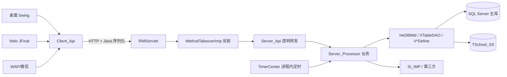

# 旧系统事实与证据

| 项目 | 内容 |
| --- | --- |
| 版本 | v1.1 |
| 状态 | 历史研究参考，非新系统技术方案或完成进度 |
| 创建日期 | 2026-10-29 |
| 更新日期 | 2026-10-30 |
| 维护 | 项目负责人；研究协作者 |
| 来源 | 原旧系统静态分析、DDL、源码和有限页面观察；原观察日期为 2026-10-22 至 2026-10-25，本次未重新实测 |
| 关联 | [项目基线](../00-项目基线/20261029-项目基线-v1.12.md)、[规则基线](../01-业务需求/20261029-业务规则与验收基线-v1.2.md)、[参考资料](../../参考资料/) |

本系统以课时为重要库存、报名为履约单元、课次财务关闭为收入确认点。保留下文的材料事实、业务链、数据约定、问题与证据；旧重构计划、技术推荐、团队与工期、开发状态全部移除。

下文技术名、数据库和源码片段只描述旧系统。单位与历史字段是迁移证据，不限制新数据库类型。旧缺陷不代表必须保留的业务规则；结算完整范围以规则基线的 0–5 六编码为准。

## 1. 分析范围、方法与局限

### 1.1 已核实的材料

| 材料 | 实际内容 |
| --- | --- |
| 源码 | 34 个 `_SRC_*.zip`，解压后 11,560 个 `.java`，约 262 万行（含注释/空行） |
| 主库脚本 | `TSchool_SQLServer.sql`，1.49 MB，682 张表、5,202 个列、1,875 条 `ALTER TABLE`、562 个外键、212 个显式索引 |
| 服务库脚本 | `TSchool_Services_SQLServer.sql`，20 KB，10 张表（作业、反馈、访谈、问卷等） |
| Web 产物 | `ROOT.war`：33 个依赖 JAR、2,061 个 `.ftl` 模板、Web 3.0 `web.xml` |
| 桌面端 | 安装目录含 38 个 JAR（登录后）、自带 JRE 8；版本号 `2026082001` |
| 手册 | 10 份 PDF、253 页；以截图为主，文字层很少 |
| 测试环境 | 登录页版本 `2026082001`，四类登录身份（员工/学员/家长/系统），jQuery + artDialog |

### 1.2 方法

- 解压全部源码包并转 UTF-8，统计模块规模、依赖、类规模、包结构；
- 解析两份 DDL：表、列、主键、外键、索引、类型分布、金额/课时字段；
- 追踪三条主链：报名→收款、班级→排课→课次、课次→消耗→结算/退费；
- 检查认证、权限、定时任务、外部集成与部署配置；
- 登录测试环境，只读查看菜单与页面结构（未提交任何业务操作）。

### 1.3 明确的局限

- 没有生产库的**最终结构**、数据量、数据质量与真实启用范围；两份 SQL 只是历史脚本。
- 没有做端到端业务提交，没有验证金额、课时、退费的实际计算结果。
- 没有做渗透测试；“可利用性”未验证，只确认代码路径存在。
- 手册是截图版，部分按钮文字只能从代码反推。
- 未取得 `ServerConfig.xml`、`Logo.xml`、连接池配置、部署拓扑与并发数据。

---

## 2. 系统全貌

### 2.1 端与角色

| 端 | 技术 | 规模 | 主要使用者 |
| --- | --- | --- | --- |
| 桌面客户端 | Java Swing + 自研框架 | 约 88 万行（Module 52.6 万、Frame 19.9 万、MIAPK 8.1 万、ClientApi 6.9 万） | 教务、课程顾问、前台财务；排课与批量操作的主战场 |
| Web 管理端 | JFinal 1.1.6 + FreeMarker + jQuery | 433 个 Java 文件、23.8 万行、2,061 个模板 | 全部岗位的日常操作，当前主推 |
| 移动 WAP / 微信 | JFinal Wap | 160 个文件、3.1 万行 | 教师课表、家长/学员查询、微信报名与支付 |
| 服务端 | Java 8、Servlet、自研 RPC/DB 框架 | 约 108 万行 | 被上述各端共同调用 |

岗位角色（来自字典与手册）：课程顾问、学习顾问、教师、教务、前台/财务、市场、系统管理员；数据权限再按学校、校区、部门、渠道、教学项目细分。

### 2.2 技术栈

| 层 | 现实情况 |
| --- | --- |
| 语言/运行时 | Java 8（JAR Manifest `Created-By: 1.8.0_112`；客户端内置 JRE 8.0.191） |
| Web 框架 | JFinal 1.1.6（2013 年版本）、FreeMarker、jQuery、artDialog，页面提示“建议 IE8 以上” |
| 桌面 | Swing 自绘组件、拖拽课表、打印/导出 |
| 远程调用 | 自研 HTTP-RMI：请求体为 ZIP 包装的 Java 原生序列化对象 |
| 数据访问 | 自研 `hean.dbmid`（`XTableDefine`/`XTableDAO`/`XViewDefine`），1,217 个表定义、301 个查询视图定义 |
| 数据库 | SQL Server，多逻辑空间：主库、只读库、学员服务库 `TSchool_SS`、CRM、留学库、军事训练库、历史库等 |
| 集成 | 微信/支付宝支付、阿里云短信、公众号/小程序、腾讯会议、ClassIn、4 家呼叫中心、CRM、电子合同、用友 NC、考勤机 |
| 构建/测试 | 无 Maven/Gradle/Ant；无 JUnit 引用；有 2,768 个 `main` 方法与 115 个 Test/Demo 类，但不是可重复执行的测试 |

### 2.3 规模画像

- **表多而窄**：682 张表、平均 7.6 列；最大表 `H_Student_Register` 63 列。
- **定制表多**：`H_` 450 张，`ZDY_`（自定义）38 张，`SS_` 37 张，`EIC_` 30 张，`SP_`/`ADF_` 各 16 张，`IDRel_` 14 张，`STAT_` 13 张，另有 `BNYS_`、`ZJ_`、`OA_`、`WeiXun_`、`ZS_`、`XKXT_`、`ADF_`、`LW_`、`GB_` 等机构前缀。
- **机构定制渗透到代码**：`EIC_` 标识符约 1.03 万处、涉及约 1,015 个文件；`ADF_` 约 8,870 处、340 个文件；另有 XDF、LW、GB、HM、JQ、BNYS、JSXL、WHJR 等。
- **多套 Web 站点并存**：`TSchool_Web`、`Web_Jian`、`Web_LX`、`Wap`、`Web_JSXL` 等各自有 BaseController/拦截器/路由，属于整站复制式定制。

---

## 3. 架构与调用链

### 3.1 远程协议

- 客户端把 `className`、`methodName`、`Object[] args`、`Class[] types` 交给 `ClientInvoke_URL.invoke()`；
- 服务端 `RMIServlet` 读取请求（支持 Base64 参数或原始流），交给 `HttpRMIServer`；
- `HttpRMIServer` 先反序列化参数，再调用 `MethodTakeoverImp`；
- `MethodTakeoverImp` 只对 `LoginControlApi` 的 `login/isEffectiveSession` 放行，其余方法先 `LoginPool.isEffectiveSession(sessionId)`，再用 `RefInvoke` 反射调用任意类名/方法名；
- `Server_Api` 层几乎全是 `return (new XxxProcessor()).yyy(...)` 的透明转发，没有权限校验。

**影响**：协议与 Java 类、字段、`serialVersionUID` 强绑定；接口清单无法静态校验；反序列化发生在会话校验之前；反射没有目标白名单。

### 3.2 数据访问层

- `T*Define` 用单字母列别名（`A`、`B`、`PR_C`…）描述表，`V*Define` 在 Java 里组合多表查询与投影；
- 典型课次视图 `VCSItemDefine` 是 **16 表 JOIN**；
- `SessionFactory.getSession()` 在代码中出现 **7,518 次**，大量 DAO 方法各自取会话/关会话；
- 事务靠手写 `beginTransaction/commit/rollback`：1,765 次 begin、1,766 次 commit、1,749 次 rollback，报名/收款/退费/关课各自跨 10–20 张表；
- 汇总表采用“明细 SUM 覆盖”或“先删后插”重算，不是增量维护。

### 3.3 前端形态

- Web 是服务端渲染 + 服务端表格：Controller 组装列定义与分页 JSON，FreeMarker 输出；
- 页面与 Controller 一一绑定，`Web_Com_StudentRegister` 11,578 行/175 个 action，`Web_Dict` 7,419 行/213 个 action；
- 定制分三层：`web_custom/<客户>` 包、24 种 `CUSTOM_DEVELOPMENT_TYPE` 分支、整站复制（Jian/LX/JSXL…）。

---

## 4. 业务域地图

| 域 | 核心能力 | 代表表 |
| --- | --- | --- |
| 组织与权限 | 机构、学校、校区、部门、员工、教师、角色、功能权限、数据范围 | `H_School`、`H_Area`、`H_Department`、`H_Employee`、`H_Role_Popedom` |
| 招生与客户 | 线索、渠道、活动、公海/私海、跟进、共享审批、资源回收 | `H_Phone_Resource`、`H_Student_Customer`、`H_Channel`、`H_Market_Activity` |
| 产品与定价 | 课程、班型、产品、版本、价格、服务费、优惠/券 | `H_Curricula`、`H_Class_Model`、`H_Product`、`H_Product_Version`、`H_Student_Coupon_Type` |
| 学员与报名 | 学员档案、多产品/多班报名、插班、合同、预合同、住宿 | `H_Student`、`H_Student_Register`、`H_Student_Register_Curricula` |
| 班级与排课 | 建班、进班、课次、教师/教室、冲突检测、调课/补课、发布确认 | `H_Class`、`H_Class_Student`、`H_CS_Item`、`H_CS_Item_Teacher` |
| 资金与结算 | 交款、支付分配、消耗、服务费、额外消费、退费、差额、锁月 | `H_Student_Money_Record`、`H_Student_Register_Pay_Record`、`H_Class_Student_CS_Item_Consume`、`H_Student_Register_Consume` |
| 教学服务 | 作业、学习反馈、访谈、问卷、考试、辅导课 | `SS_*`（学员服务库） |
| 报表与审计 | 招生/收入/消耗/绩效/教室使用、操作日志、导出 | `STAT_*`、`H_Log_*` |
| 审批与办公 | 转班/退班/延期/退费/优惠审批、任务、工作日志 | `H_Flow*`、`H_Form*`、`SP_Flow_*`、`OA_*` |

### 4.1 三条主链

**链一：线索 → 学员 → 报名 → 收款 → 进班**

- 一条学员可以有多条报名记录；一次“报两个班/两个产品”会产生多条报名记录（手册明确）；
- 报名有普通、到班、多产品连报、仅服务费、插班、住宿、预合同等入口，核心都落到 `StudentMultRegisterCreateProcessor.addStudentRegister`（797 行）；
- 报名写入：学员 → 报名主表 → 报名课程 → 服务费 → 产品 → 住宿/附件 → 预进班 → 券 → 汇总 → 消息/事件；
- 收款与报名支付分离：`H_Student_Money_Record` 记收到的钱，`H_Student_Register_Pay_Record` 记钱分配到哪条报名；支付/缴费/账单共用同一个 `Code`。

**链二：班级 → 课次 → 排课 → 发布 → 确认 → 关闭**

- `H_Class_Student` 的主键是 `Student_Register_Code`，意味着**一条报名当前最多关联一个班**；转班/补课通过其他表表达；
- 课次 `H_CS_Item` 是统一占用对象：班级 + 日期 + 起止分钟 + 课程 + 教师 A/B/C + 教室 + 状态；
- 状态不是状态机，而是 7 个独立布尔：`Is_Audited`（发布）、`Is_Confirm`（确认）、`Is_Closed`（关闭）、`Is_Locked`、`Is_Been_Combo`、`Is_BK`、`Is_Has_Compensation`；
- 关闭课次会在一个事务里改状态、写财务固化、按学员删后重插消费、生成差额、更新汇总。

**链三：关闭 → 消耗 → 汇总 → 报表 / 退费**

- 消费明细 `H_Class_Student_CS_Item_Consume`（报名 × 课次），报名汇总 `H_Student_Register_Consume`，学员汇总 `H_Student_Consume`；
- 汇总由明细全量重算；`Consume_EHM` 是“分 × 60”的特殊单位；
- 退课时、退费、错误冲销、差额是不同单据；差额月份取 `max(锁定月+1, 课次月)`。

### 4.2 旧实现的单位与业务不变量（非目标存储方案）

1. 旧实现金额以“分”为整数落库（`Money.MULTIPLE = 100`），不要用浮点。
2. 旧实现课时以 0.01 课时为整数落库（`CSHour.MULTIPLE = 100`）。
3. `Consume_EHM` 是“分 × 60”，写库前不再舍入，尾差另有修正逻辑。
4. 汇总必须能由明细全量重算，且重算结果与增量一致。
5. 欠款 =（价 − 优惠）+ 额外消费 + 服务费 − 退费 − 服务费退费 − 已付。
6. 每（报名，课次）最多一条消费行；重算采用先删后插。
7. 已固化课次的金额不可改，只能追加差额。
8. 退费的课时/金额是**累计值**，不是本次值。
9. 支付、缴费、账单同码，支付分配必须守恒（分到课程/服务费/退费）。
10. 课次状态转换必须成对可逆，且发布/确认/关闭/锁定/补课各有前置条件。
11. 锁顺序：客户资源 → 学员 → 班级，避免死锁。

---

## 5. 数据模型与数据约定

### 5.1 结构特征

- 682 张表、5,202 列；**没有数据库视图、存储过程、函数、触发器**（DDL 中均未出现），全部逻辑在 Java。
- 外键只有 562 个，527 张表参与外键；大量表靠应用层维护关系，**123 张表既不引用别人也不被引用**。
- 212 个显式索引，只覆盖 125 张表；`H_Student_Register_Consume`（报名汇总）**没有索引**。
- 主键几乎全是 `varchar(20)` 业务编码；没有统一自增代理键。
- 金额列用 `bigint`（分），课时用 `int`（0.01 课时），日期用 `int`（`yyyyMMdd`），创建时间用 `bigint`（单位需按写入点核实，存在毫秒/秒混用风险）。
- 大量 `text/ntext/image` 列存富文本、附件、照片。

### 5.2 脚本本身不是可重放迁移集

- 主库脚本混合 `CREATE TABLE`（带 `IF NOT EXISTS` 守卫）与 1,875 条 `ALTER TABLE`，没有版本号，最终结构取决于执行顺序与原库状态。
- 服务库脚本开头会**先删除当前库的所有默认值、唯一约束、外键和索引**，再建表；直接在现有库执行会改坏结构。
- 两份脚本都没有 `INSERT`，只有 7 条 `UPDATE`；没有初始化数据，不能仅凭脚本还原一套可运行环境。

### 5.3 迁移口径

新系统应以**生产库导出的最终结构 + 脱敏样本**为基线，不从脚本重放。迁移至少要对平：

- 学员数、在读报名数、未完成课次数；
- 账户余额、报名余额、剩余课时；
- 已收款/已消耗/已退费/差额按月的收入；
- 锁定月份与已审核单据；
- 特殊占位值（`--`）与负数课时/金额。

---

## 6. 主要问题（按严重度）

### P0：安全与合规

| 问题 | 证据 | 影响 |
| --- | --- | --- |
| 登录日志写明文密码 | `LoginControl.java:112` 拼接 `getUserPassword()` | 凭据进入日志，任何能看日志的人可复用 |
| 密码无盐 MD5 | `Password.java:49-62` | 拖库即彩虹表；无法满足等保/审计要求 |
| 空密码直接通过 | `Password.validate()` 旧密码为空即 `true`（`:22-29`） | 空口令账户可被空口令登录 |
| 内部账号只校验用户名 | `InnerUserLogin.java:23-36` | 知道用户名即可获得内置身份 |
| 硬编码主密码（具体值不记录） | `AuthUtil.java:52,66`、`BaseController.java:115` | 源码/反编译即可得 |
| 服务器主密码兜底 | `LoginControl.java:454-461` | 任意账户可用配置中的主密码登录 |
| 会话只存进程内 HashMap | `LoginPool.java:35,58` | 重启全员掉线；多实例不共享；无过期 |
| 反序列化先于会话校验 | `RMIServlet` → `HttpRMIServer` → `MethodTakeoverImp` | 未认证请求即可触发 Java 反序列化 |
| 反射无白名单 | `MethodTakeoverImp.java:45` | 会话有效即可调用任意暴露类方法 |
| `/si` 无签名、CORS `*` | `ServiceInterfaceServlet`、`SIServlet.java:51` | 接口可被跨站调用/重放 |
| 微信支付回调不验签 | `Pay_WX.java:37-49` | 伪造支付成功通知（可利用性未验证） |
| 文件导出从 URL 取 sessionID | `NeedLoginInterceptor.java:65-76`、`FileExport.java:32-38` | 会话参数出现在 URL/日志/Referer |

> 说明：以上是代码事实，未做攻击验证；生产是否可达取决于部署、网关与网络策略。

### P0：数据一致性与并发

- **事务只捕获 `SQLException` 回滚**：运行期异常不回滚，可能留下半条报名/半个课次。
- **批量操作逐条提交**：收款按报名逐条 commit，课次关闭按班级逐班 commit；中途失败即“部分成功”，且没有补偿单据。
- **内存锁不跨进程**：`LockPool` 按班级/学员加锁，多个 JVM 之间无效；缓存 `IADataPool` 靠本地事件失效，多节点会按陈旧数据排课。
- **条件更新静默跳过**：确认/关闭用 `update ... where` 影响行数不校验，并发时调用方误以为成功。
- **汇总与明细可能不一致**：重算是“先删后插”，失败会丢明细；没有对账任务。
- **定时任务无租约**：`TimerCenter` 每 2 秒轮询，每个任务每次新建线程；多实例重复执行短信、结算、会议回写。

### P1：可维护性

- 超大类/方法：`Web_Com_StudentRegister` 11,578 行、`addStudentRegister` 797 行、退费方法 1,081 行。
- 复制粘贴：`addStudentRegisterInfo` 两份、班级筛选两份、5 套 Web 站点、2 套 IACS 实现。
- 三张反射字符串注册表：RPC 305 项、审计对象 775 项、定时任务 30+ 项，契约无法静态校验。
- 授权散点：Web 层 `isExistPopedom` 875 处、数据范围判断 562 处，没有统一拦截器。
- 定制下沉到后端与调度器：24 种机构版本开关、`processor_custom` 339 个文件、按客户注册定时任务。
- 无构建脚本、无依赖锁定、无自动化测试；核心框架 JAR 无源码，旧系统本身难以重建。

### P1：性能

- 课次视图 16 表 JOIN，单班课表另有 8–10 次附加查询。
- 冲突检测默认 62 天窗口，逐日把全校当天课次全量读入内存，再两两比较，最坏 O(k²)。
- 排课过程反复全量取数 + 排序；批量写逐条执行。
- 212 个索引覆盖 125/682 张表，热点汇总表无索引；查询频繁新建会话/连接。
- 所有会话、锁、缓存、定时器都在单 JVM，无法水平扩展；只能靠加机器 + 会话粘滞，容量上限低。

### P2：工程化与运维

- 版本靠 `2026082001` 这类标签，源码包、安装包、服务端、数据库之间的对应关系不清晰。
- 日志、指标、追踪缺失；异常多为 `catch → log → 抛 XException`，没有统一错误码。
- 文件存数据库 `image/text` 列，备份与迁移成本高。
- 外部集成失败无重试/补偿，短信、会议回写、支付通知都可能丢。

---

## 附录 A：关键证据索引

| 主题 | 位置 |
| --- | --- |
| 金额单位 | `参考资料/analysis-v2/src-utf8/TSchool_Com/.../define/Money.java:9` |
| 课时单位 | `参考资料/analysis-v2/src-utf8/TSchool_Com/.../define/CSHour.java:8` |
| 密码 MD5 | `参考资料/analysis-v2/src-utf8/TSchool_Server_Com/.../utils/Password.java:42-62` |
| 密码日志 | `参考资料/analysis-v2/src-utf8/TSchool_Server_Processor/.../LoginControl.java:112` |
| 主密码兜底 | 同上 `:454-461` |
| 内部账号免密 | `参考资料/analysis-v2/src-utf8/TSchool_Server_Processor/.../InnerUserLogin.java:23-36` |
| 硬编码密码 | `参考资料/analysis-v2/src-utf8/TSchool_Web/.../auth/AuthUtil.java:52,66` |
| 会话池 | `参考资料/analysis-v2/src-utf8/TSchool_Server_Processor/.../_login/LoginPool.java:35,58` |
| RPC 入口 | `参考资料/analysis-v2/src-utf8/TSchool_Server_Servlet/.../RMIServlet.java:73` |
| 反射调用 | `参考资料/analysis-v2/src-utf8/TSchool_Server_Servlet/.../MethodTakeoverImp.java:45` |
| 报名主流程 | `参考资料/analysis-v2/src-utf8/TSchool_Server_Processor/.../register/StudentMultRegisterCreateProcessor.java:872-1668` |
| 课次关闭 | `参考资料/analysis-v2/src-utf8/TSchool_Server_Processor/.../iacs/CSItemClose.java:263-311` |
| 冲突检测 | `参考资料/analysis-v2/src-utf8/TSchool_Server_Processor/.../iacs/clash/AllClashCheck.java` |
| 定时器 | `参考资料/analysis-v2/src-utf8/TSchool_Server_Frame/.../timer/TimerCenter.java:73-87` |
| 路由注册 | `参考资料/analysis-v2/src-utf8/TSchool_Web/.../config/WebConfig.java:244-717` |
| 课次视图 | `参考资料/analysis-v2/src-utf8/TSchool_Server_DB/.../view/VCSItemDefine.java` |

## 附录 B：本次生成的统计文件

- `参考资料/analysis-v2/sql-summary.json`：两份 DDL 的规模、类型、索引、外键统计。
- `参考资料/analysis-v2/sql-tables-*.json`：逐表列定义与主键。
- `参考资料/analysis-v2/sql-fks-*.json`、`sql-indexes-*.json`：外键与索引清单。
- `参考资料/analysis-v2/code-summary.json`：模块、import、类规模、包结构。
- `参考资料/analysis-v2/src-utf8/`：UTF-8 源码阅读副本（原包未修改）。
